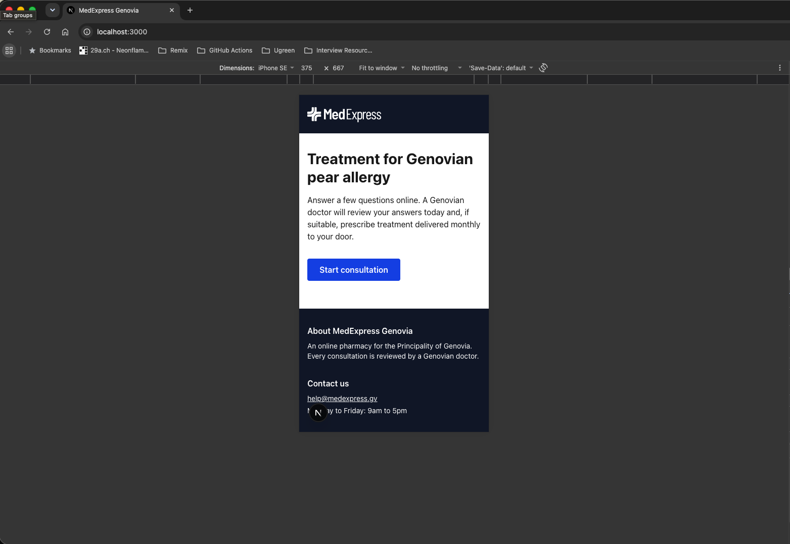
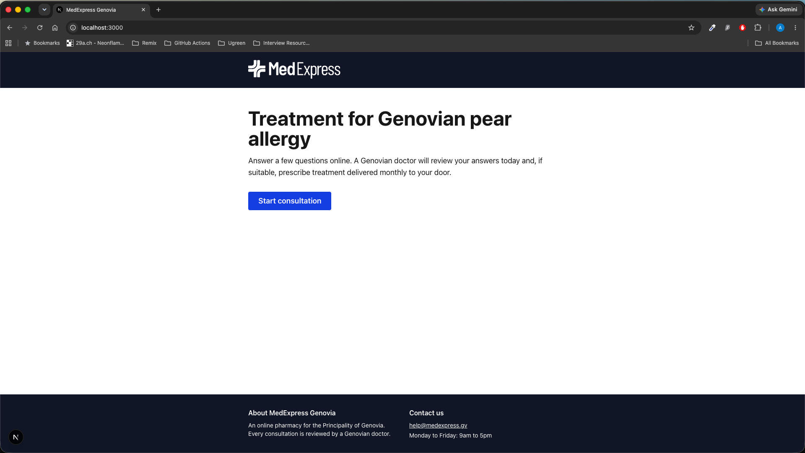
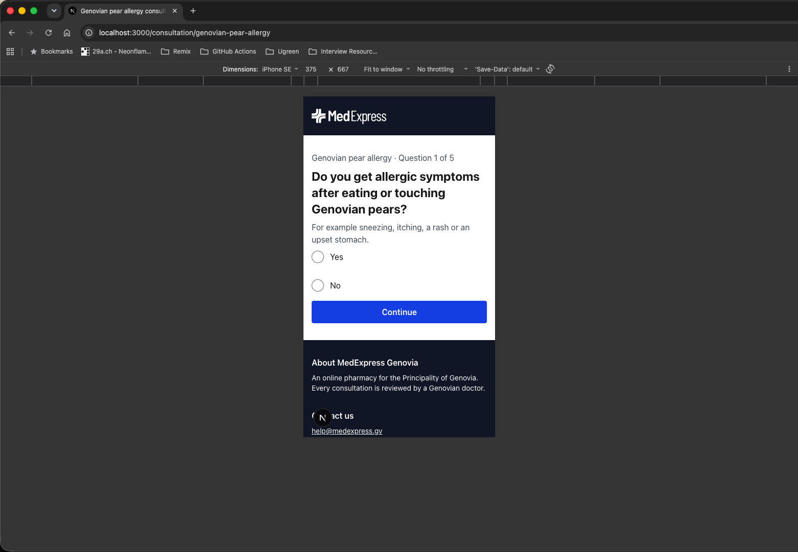
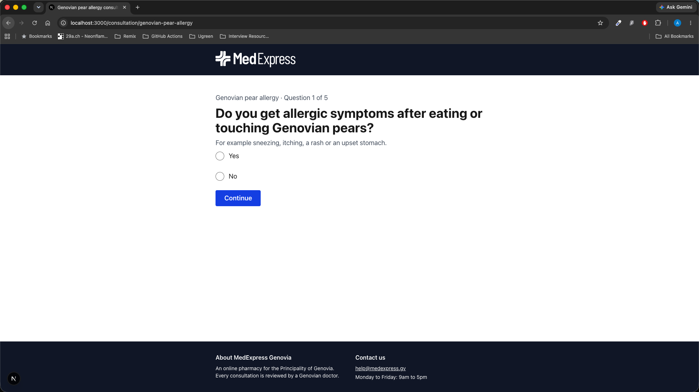
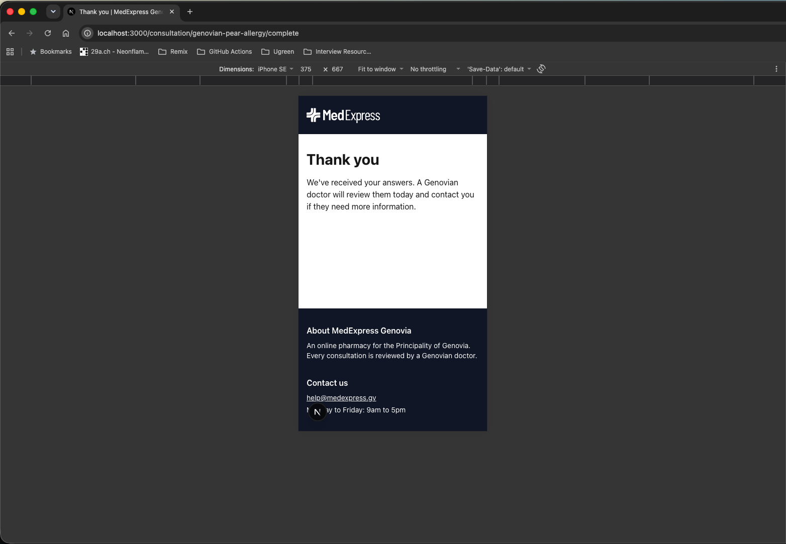
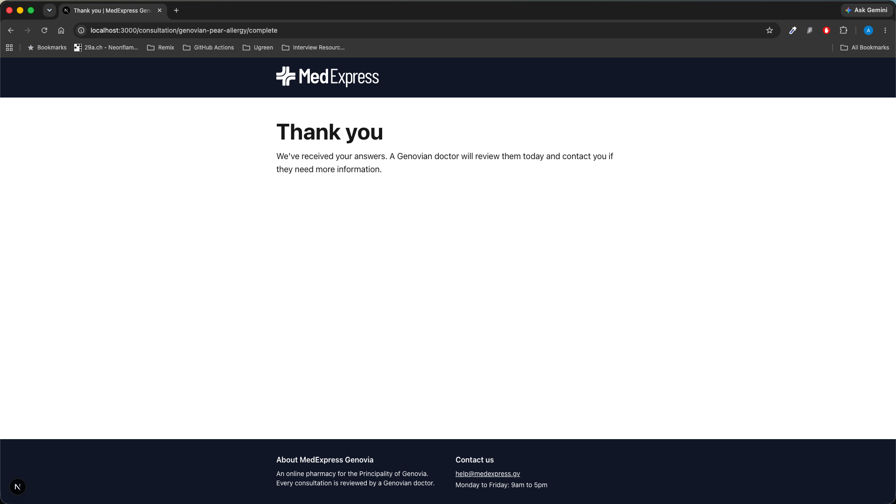

# MedExpress Genovia: Consultation

The consultation step of the MedExpress journey for **Genovian pear allergy**, built for the HeliosX frontend take-home Patients answer five yes/no questions, one at a time, and their answers are passed to a service (which logs them, standing in for an API) before a thank-you page. It's built with Next.js 16, TypeScript and Tailwind, with a faux CMS, saved progress, and unit, feature and page tests.

## Getting started

**Requirements:** Node 22 (see `.nvmrc`; `nvm use` picks
it up)

```bash
npm install
npm run dev        # http://localhost:3000
```

| Command             | What it does                                           |
| ------------------- | ------------------------------------------------------ |
| `npm run dev`       | Development server                                     |
| `npm run build`     | Production build (consultation pages are pre-rendered) |
| `npm run start`     | Serve the production build                             |
| `npm run test`      | Vitest in watch mode                                   |
| `npm run test:run`  | Run all tests once                                     |
| `npm run typecheck` | TypeScript, no emit                                    |
| `npm run lint`      | ESLint                                                 |

**Where's the submitted data?** After submitting the last
question, the payload is logged
to the **browser console** by `submitConsultation`
(`src/features/Consultation/service.ts`).

## The journey

1. Landing page (`/`): "Start consultation"
2. Consultation (`/consultation/genovian-pear-allergy`):
   5 yes/no questions, one at a time
3. Thank-you page
   (`/consultation/genovian-pear-allergy/complete`)

### Screenshots

|               | Mobile (375px)                                                                                                                                                              | Desktop                                                                                                                                                          |
| ------------- | --------------------------------------------------------------------------------------------------------------------------------------------------------------------------- | ---------------------------------------------------------------------------------------------------------------------------------------------------------------- |
| **Landing**   |                                |                                             |
| **Question**  |  |  |
| **Thank you** |                                                                                 |                                                                    |

## Tech stack

- **Next.js 16** (App Router) + **TypeScript**
- **Tailwind CSS v4**
- **zod**: validates CMS data and restored session data
- **Vitest**, **React Testing Library**, **vitest-axe**

I chose Next.js over Vite because the product is about to grow to more conditions: one dynamic route with generateStaticParams pre-builds a page for each condition in the CMS, Server Components keep CMS loading and validation out of the browser bundle, and routing, metadata and the screen reader route announcer are built in. The cost is more framework concepts than a Vite single-page app.

## Structure

```
src/
  app/            # routes: thin; fetch data, notFound(), render a feature(s)
  features/       # one public component per feature (Consultation)
  components/     # presentational only: props in, markup out
  lib/            # data layer: faux CMS, schema, routes
  locales/en/     # UI text by namespace (i18n-ready, no library yet)
  utils/          # cn, formatLocaleString
```

- app/: routes. Pages are thin: they handle routing, fetch data (the faux CMS), call notFound(), set metadata, and compose one or more features.
- features/: everything a feature needs beyond fetching its data: state and rules (a pure reducer), side effects (submission,sessionStorage, redirects), and domain-specific UI. Each feature exposes one public component, is built from the presentational components,
  and never imports another feature.
- components/: presentational and app-agnostic. Props determine content, appearance and behaviour (labels, variants, checked, onChange); they contain no business logic, data fetching or app copy, so they could be reused in any project.
- lib/: shared data layer (CMS access, zod schemas, routes). locales/: interface text by namespace. utils/:small generic helpers.

## Key decisions

### Questions come from a faux CMS

`lib/cms.ts` stands in for a headless CMS: `getConsultation(slug)` returns data typed as `unknown` until a zod schema parses it, just as a real API response would be. Questions are a discriminated union on a semantic `type` (`"yesNo"`, not `"radio"`), so the content describes _what_ is asked and the UI decides _how_ to show it. The schema also requires unique question ids, since answers are keyed by id. An unknown slug returns a 404; invalid content throws, which fails the build because pages are statically generated, so broken content never reaches users. Each consultation has a `version`, which is sent with the submission and used to invalidate saved progress when the questions change.

### State: a pure reducer and a thin hook

All the rules live in `consultationReducer`, a pure function with no React: validation (you can't continue without an answer), navigation, and locking while submitting. Invalid actions, such as a double-clicked Submit or Back while sending, return the same state, so they do nothing. Small selectors (`isLocked`, `isComplete`, `isLastStep`) keep each rule in one place. `useConsultation` connects the reducer to React and does the async work in event handlers, not effects. Answers are stored as `Record<QuestionId, AnswerValue>` (booleans today); the question content stays in props rather than being copied into state.

### Native radios and Continue, not auto-advance

The live MedExpress site auto-advances when an option is chosen. I used native radios with an explicit Continue button: a radio group correctly describes "choose one of these" to assistive technology, arrow keys select radios (so auto-advancing on selection would move keyboard users on before they'd finished choosing), and changing context on selection fails WCAG 3.2.2. It also lets users change their mind before continuing, and the same pattern will work for checkbox and text questions. If auto-advance were required, the accessible version would be answer buttons that submit, not radios.

### Form semantics and accessibility

- One `<form>`; each question is a `fieldset` whose `legend` holds the question as the page's `h1`, with "Condition · Question X of 5" as a caption.
- The hint and the validation error sit _outside_ the legend and are linked with `aria-describedby`, so they're read once when entering the group, not repeated before every option.
- Continue and Submit are always enabled; pressing without an answer shows "Select yes or no" (the GOV.UK pattern), avoiding disabled buttons that can't be focused or explained.
- Back is hidden on the first question, and is `type="button"` so Enter never goes backwards.
- While submitting, the button uses `aria-disabled` rather than `disabled`, so keyboard focus isn't lost; submission errors use `role="alert"` so they're announced immediately.
- A skip link, landmarks, visible focus styles and 44px tap targets throughout; axe checks run in the tests.

### Every question type must have UI

`QuestionStep` switches on `question.type`, and its `default` case assigns the type to `never`. Adding a type to the schema without UI for it is a compile error, so it can't ship by accident. A runtime `throw` covers bad data that somehow gets past validation.

### Components: one public component per feature

`app/` pages are thin; `features/Consultation` owns the flow and exposes one component through its `index.ts`, and an ESLint `no-restricted-imports` rule stops code outside the feature from importing its internal files; `components/` are presentational and app-agnostic. `Fieldset` started as `RadioGroup`, and I renamed it once it was clear nothing in it was specific to radios: it's the legend, hint, error and `aria-describedby` wiring that any grouped question (checkboxes, a day/month/year date) would reuse. `Radio` throws a clear error if it's rendered outside a `Fieldset`. `Button` has primary and secondary variants, each with its own disabled styling, and defaults to `type="button"`, so a button only submits a form when that's stated explicitly.

### The thank-you page is a separate route

After a successful submission, the component calls `redirect()` (replacing the history entry) to `/consultation/[condition]/complete`. Refreshing keeps the confirmation, browser Back doesn't return to a completed form, and Next's route announcer reads the new page title to screen readers. The payload is `{ condition, consultationVersion, answers: [{ questionId, questionText, answer }], submittedAt }`: the question text and version are included so the doctor sees exactly what was asked.

### Progress is saved in sessionStorage

Refreshing mid-consultation used to lose every answer. Progress (the step and answers only) is now saved in `sessionStorage`: per tab, cleared when the tab closes, and never sent to a server, which is the safer default for health data. The key includes the question version; restored data is validated with zod, and the reducer drops answers for questions that no longer exist and never restores past the first unanswered question. Storage is cleared after a successful submission.

Two details came out of testing. Under React Strict Mode (which `next dev` uses), effects run twice on mount, and the save effect overwrote saved progress with the empty initial state before it was restored. A `hasRestored` flag fixed it: nothing is saved until the restore has been applied, so the effects are safe to repeat. Second, the server always renders question 1 because it can't see browser storage, so returning users saw it flash. The form now stays `invisible` (keeping its space, so nothing jumps) until the restore finishes.

I didn't use cookies: they'd send health answers with every request and would stop the pages being statically generated. In production, progress would be a server-side draft linked to an opaque, `httpOnly` session id.

### Interface text lives in `locales/`

Content that varies per condition (question text, hints) comes from the CMS; interface text (Back, Continue, Yes/No, errors) comes from `locales/en/`, one file per namespace (`common`, `home`, `consultation`). It mirrors how react-i18next and next-intl organise translations, with `{placeholder}` strings rather than functions, so adding a translation library later is mostly a matter of converting the files to JSON.

### Responsive, mobile-first

Base styles are for mobile, and Tailwind prefixes add changes for wider screens. Headings and body text grow at `md:`/`lg:`; on mobile the buttons are full width and stacked with Continue on top (using `flex-col-reverse`, so the order in the HTML, and therefore for keyboard and screen reader users, doesn't change); the footer becomes two columns from `md:`; the logo grows with the screen. Mobile-first also means the layout works at 200% browser zoom.

## Testing

- **Unit:** reducer (incl. RESTORE), buildSubmission, service, storage, CMS/schema, formatLocaleString
- **Feature:** validation, Back, payload, redirect, failure + retry, aria-describedby, unsupported type, saved progress (incl. Strict Mode reload), axe
- **Pages:** consultation page: static params, metadata, renders from CMS, 404

**Not tested:** thank-you page (static copy);

## Trade-offs and what I'd do with more time

### Out of scope (per the brief)

- **Payment, subscription, doctor review and dispatch.** Only the consultation step is built.
- **A real API.** `submitConsultation` waits 500ms (to mimic the network, so the "Submitting…" state is visible) and logs the payload.
- **Clinically realistic questions or eligibility logic**, **localisation** and **regulatory requirements**.
- **Visual polish.** The styling is deliberately simple: Tailwind defaults plus the MedExpress logo.

### Deliberately deferred

- **Focus management between steps.** At the moment a screen reader user isn't told when the question changes. The heading already has `tabIndex={-1}` and accepts a `ref`, so the next step is an effect that moves focus to the new heading when the question number changes (comparing with the previous value, so it skips the first load and copes with Strict Mode), plus focusing the first option in the submit handler on a validation error, so the linked error is announced on every press. The thank-you page doesn't need it: Next's route announcer reads its title.
- **A "check your answers" step** before submitting (the GOV.UK pattern). The brief goes straight from the last question to thank-you, so I followed it.
- **Custom `error.tsx` and `not-found.tsx`.** Next's default pages are used. Invalid CMS content fails the build rather than reaching users, and unknown conditions return the default 404.
- **Server-side drafts instead of sessionStorage.** With a backend, each answer would be saved to a draft consultation linked to an opaque `httpOnly` session id: progress would work across devices, no health data would be stored in the browser, and the server could render the correct step (no hidden-until-restored moment).
- **A form library** (e.g. React Hook Form). The reducer is simpler for 5 yes/no questions; a library becomes worthwhile once there are text, multi-select and date questions with their own validation. zod is already used where data enters the app.
- **Dark mode.** The scaffold's half-finished dark-mode CSS was removed because the components assume a light background. Doing it properly means colour tokens and `dark:` variants per component.
- **Storybook** for the presentational components (`Button`, `Fieldset`, `Radio`, `HelpText`), with a story for each state and the accessibility addon.
- **Playwright end-to-end tests**, including a real-browser axe run (jsdom can't check colour contrast), and **CI** running lint, types, tests and build on every push.

### Known limitations of the current build

- **Browser Back leaves the consultation** rather than going to the previous question, because the step isn't in the URL. Saved progress means nothing is lost; syncing the step to the URL would make Back work question by question.
- **"Answered" means `!== undefined`.** That's correct for yes/no, but multi-select (`[]`) or text (`""`) questions will need a per-type check.
- **`QuestionId` is a type alias, not a branded type.** It documents intent, but TypeScript still accepts any string; zod's `.brand()` would catch mixed-up ids, at the cost of casts in test fixtures.
- **`getConsultation` is called twice per page** (once for metadata, once for the page). That's harmless with local data; with a real CMS I'd wrap it in React's `cache()`.
- **Features can still import each other.** Code outside `features/` can only import a feature through its `index.ts` (enforced by ESLint), but nothing yet stops one feature reaching into another; with a second feature I'd add a rule for that too.
- **The landing page is hard-coded** for the one condition. With more conditions, each landing page would come from the CMS.

### Process

- **I committed straight to `main`.** Normally I'd work on feature branches and merge through pull requests with review and CI. For a short, solo exercise, small commits on `main` keep the history readable without that overhead.
